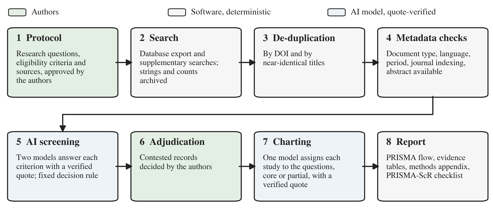
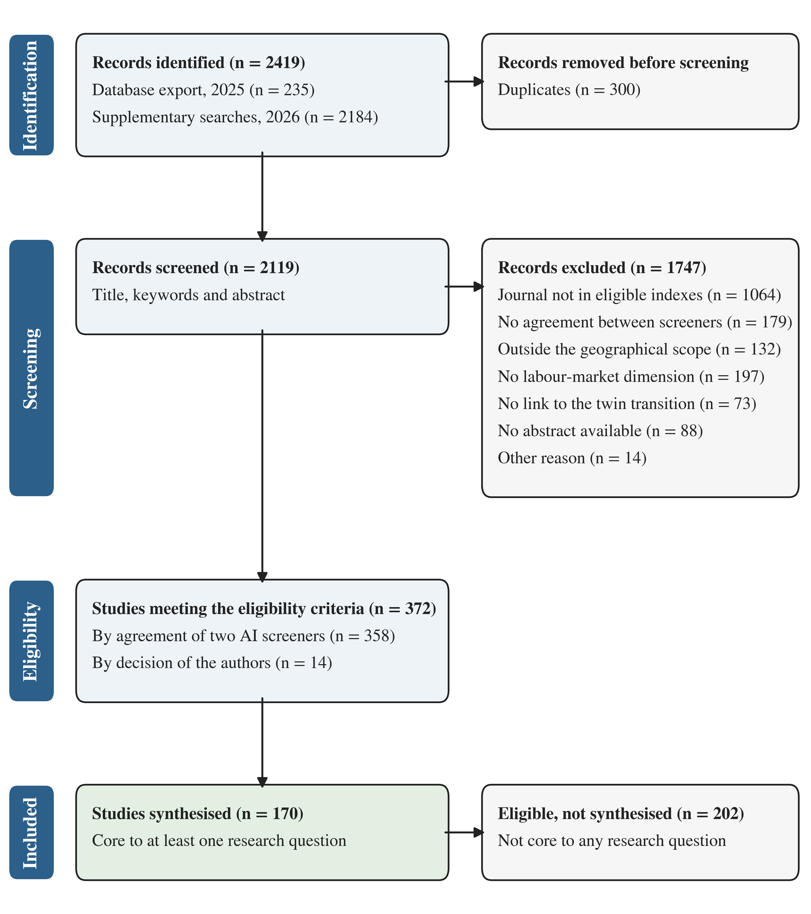
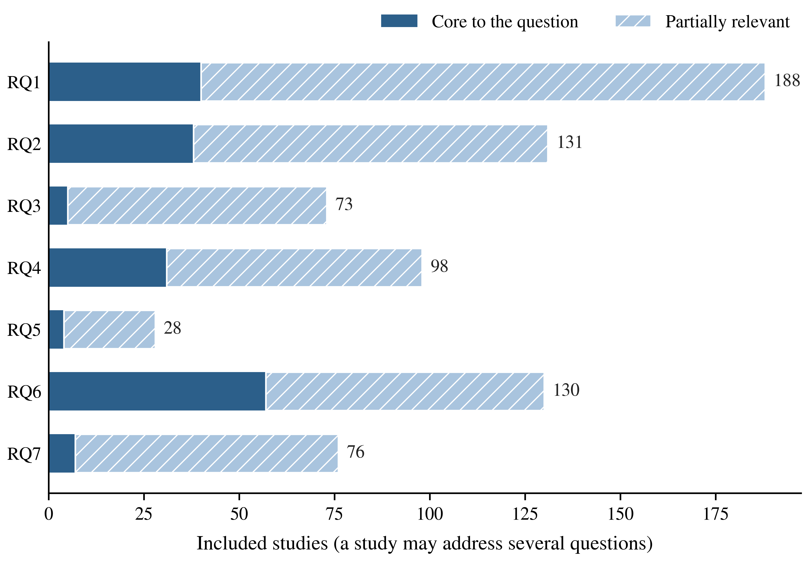
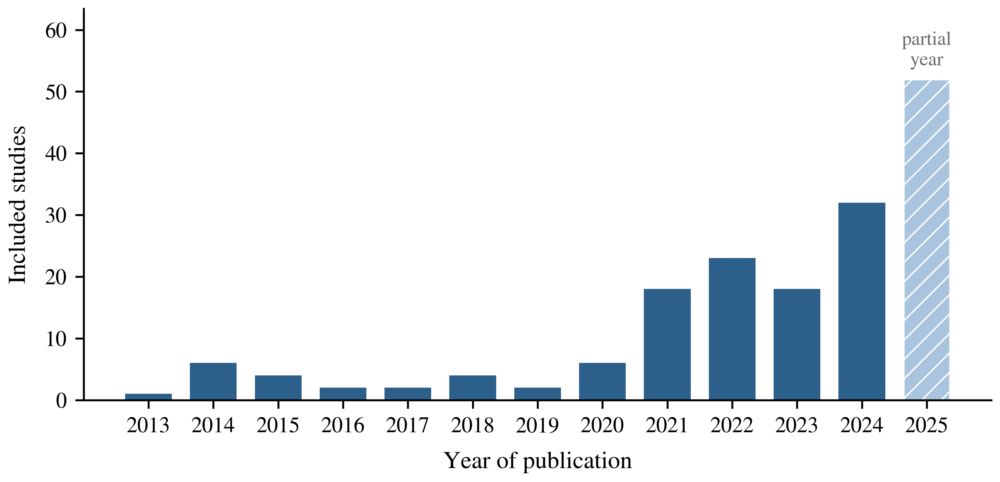

```{=openxml}
<w:p><w:r><w:br w:type="page"/></w:r></w:p>
```

# How to use this document

Part I maps every reviewer comment that concerns the method onto the change made and the place where it is
reported. Part II is the new text of Section 2 of the chapter, ready to replace the 2025 text. Part III is the new
text of Section 3 (results of the review). Part IV is Appendix A (sources, search strings, eligibility criteria
and the PRISMA-ScR checklist). Part V gives the draft response to each comment, in the form used in the response
letter. All counts come from the run's artefacts (`prisma_counts.json`, `screening_stats.json`,
`methods_appendix.md`); the wording can be edited freely, the numbers must not.

Points the authors must still decide are marked **[authors]**.

```{=openxml}
<w:p><w:r><w:br w:type="page"/></w:r></w:p>
```

# Part I. Reviewer comments on the method and where each is answered

| # | Comment (abridged) | What changes | Where |
|---|---|---|---|
| R1-1 | More detail for reproducibility: model, databases, final strings | Section 2.3–2.5 name the models and versions, the sources and dates; strings in Appendix A | 2.3, 2.4, App. A1 |
| R1-2 | PRISMA-style flow diagram | Figure 2, generated from the run | 3.1, Fig. 2 |
| R1-3 | How the AI output was checked; loosely related assignments; duplicate Peru entries | Section 2.4–2.5 explain quote verification, the decision rule and the authors' adjudication; the 2025 corpus (and its duplicates) is no longer used | 2.4, 2.5, 2.7 |
| R1-4 | Method text aligned with Figure 1; every step and output explained | Figure 1 redrawn with eight steps; each step is a numbered paragraph in 2.2–2.6 and its output is named | 2.2–2.6, Fig. 1 |
| R1-5 | "PI" instead of "RQ" in Figure 3 | Figures regenerated with RQ labels | Fig. 3, Fig. 4 |
| R1-6 | Chain of Thought both cited and footnoted | Chain-of-thought passage removed with the agent-theory pages | 2.1 |
| R1-7 | Agent references two decades old | Agent discussion reduced to one paragraph; **[authors]** add one or two recent references on LLM agents for literature review | 2.1 |
| R2-M1 | Report the method in reproducible detail (models, prompts, strings, databases, dates, counts, PRISMA flow and checklist, criteria, how many decisions by the researchers, abstracts vs full texts); inconsistent list of steps | All items in 2.2–2.7 and Appendix A; eight steps consistent between text and Figure 1 | 2, App. A |
| R2-M2 | Validate PALET; drop the claim of objectivity; limitations paragraph; the Perancho (2025) working paper | "Objective" and "complete sweep" removed; inter-model agreement reported as such; no validation against human screening, stated as a limitation; Perancho (2025) no longer cited for the method | 2.1, 2.4, 2.7 |
| R2-M3 | Off-topic papers; uneven distribution; re-screen with explicit criteria and report exclusions | The corpus was rebuilt: explicit criteria (Table 2), re-screening of the 2025 export and seven supplementary searches, exclusions with reasons (Fig. 2), uneven coverage discussed as a result | 2.2, 3, Fig. 2 |
| R2-M6 (part) | "Brief meta-analysis" is descriptive bibliometrics | Section 3 renamed "Results of the review: the corpus" | 3 |
| R2 minor | Subject–verb agreement in the PALET paragraphs; "If results seem excessive…" sentence; "i.e." for "e.g." | Text rewritten; the sentences no longer exist | 2 |

Comments on Section 4 (M4, M5) and on the Introduction are answered by the rewrite of those sections and are not
covered here, except that the new corpus makes M3, M4 and M5 one answer (see Part V).

```{=openxml}
<w:p><w:r><w:br w:type="page"/></w:r></w:p>
```

# Part II. Section 2 — Method: an AI-assisted scoping review

## 2.1 Approach

The review follows the PRISMA extension for scoping reviews (PRISMA-ScR; Tricco et al., 2018). It was carried
out with the Prompt-based Automated Literature Extraction Tool (PALET), a software pipeline developed by the
authors in which large language models (LLMs) perform two bounded tasks, screening records against
pre-specified criteria and charting the included studies, while every decision rule, every count and every quote
is recorded so that the run can be inspected and replayed. PALET can be described as a software agent in the weak
sense of Wooldridge and Jennings (1995): it operates on a written protocol without continuous intervention,
reacts to what each step returns and reports to the researchers at fixed points. **[authors: one or two recent
references on LLM-assisted screening or agents for evidence synthesis, to answer R1-7.]** What the models do and
do not do is stated below. They did not set the research questions or the criteria, they did not decide
inclusion on their own, and they did not write the synthesis.

The first version of this chapter was prepared with an earlier version of the tool and a corpus of 142 papers.
The reviewers asked for explicit criteria, a reproducible search, a flow diagram and a check of the selection.
Meeting those requests produced a different corpus: the 2025 export was re-screened against the explicit criteria
and seven supplementary searches were added. The present version is written on the resulting corpus. Figure 1
shows the eight steps of the procedure; the following subsections describe each step, its inputs and its outputs.

**Figure 1.** The PALET procedure as applied in this review.



*Source: own. Green: steps taken by the authors; grey: deterministic software; blue: steps performed by an AI model
whose every answer is tied to a passage of the record that the software verifies.*

## 2.2 Step 1 — Protocol

The protocol fixes the research questions (Table 1), the eligibility criteria (Table 2), the sources and the
decision rules before any screening takes place. It is a versioned file whose hash is recorded in the run; version
2, applied here, was approved by both authors on 14 November 2026. The protocol was not registered in a public
registry. The seven research questions are those of the first version, with one change: RQ3 now names the problem
to which cohesion and smart-specialisation policies are to be related ("…to address job creation and destruction
linked to the green and digital transition in EU regions"); the original wording did not, which is one reason the
first corpus contained regional-policy studies unrelated to the transition.

**Table 1.** Research questions.

| | Research question |
|---|---|
| RQ1 | What economic-policy recommendations does the literature formulate to mitigate job destruction and boost job creation associated with the green transition in the EU? |
| RQ2 | What recommendations does the literature provide regarding the impact of digitalisation and artificial intelligence on JCD in the EU? |
| RQ3 | What cohesion or smart-specialisation policies does the evidence suggest to address job creation and destruction linked to the green and digital transition in EU regions? |
| RQ4 | Which initial-education and lifelong-learning models are most effective for adapting green and digital skills? |
| RQ5 | What role do immigration and labour mobility play in filling skill gaps during the transition? |
| RQ6 | How should just-transition policies be designed to prevent green and digital discontent in territories that depend on fossil fuels or have low levels of digitalisation? |
| RQ7 | What knowledge gaps persist regarding the measurement and forecasting of JCD and the effectiveness of the cited policies? |

*Source: own.*

**Table 2.** Eligibility criteria.

| ID | Criterion | Checked by |
|---|---|---|
| IC1 | Empirical or policy focus on EU-27 member states or their regions, the United Kingdom, or EFTA countries (Iceland, Liechtenstein, Norway, Switzerland). Multi-country or global studies qualify only if they report results specific to these countries or to the EU | AI screening |
| IC2 | Addresses employment, jobs, job creation or destruction, skills, labour markets, or labour mobility or migration of workers | AI screening |
| IC3 | Linked to the green transition (decarbonisation, energy transition, climate policy, just transition) and/or the digital transition (digitalisation, automation, artificial intelligence, ICT, Industry 4.0) | AI screening |
| IC4 | Peer-reviewed journal article or review, published 2013–2025, in English or Spanish | Metadata |
| IC5 | Journal indexed in the Science Citation Index Expanded or the Social Sciences Citation Index (Web of Science master journal lists, June 2026) or the Emerging Sources Citation Index (August 2025) | Metadata, by ISSN |
| EC1 | Exclusively non-European setting without EU- or Europe-specific results | AI screening |
| EC2 | No labour-market dimension (purely environmental, technical, fiscal or financial analysis) | AI screening |
| EC3 | No link to the green or digital transition (e.g. general regional convergence or cohesion analysis without a transition component) | AI screening |

*Source: own. Records with no retrievable abstract were not eligible (see 2.4).*

## 2.3 Step 2 — Information sources and searches

Two kinds of source were used (Appendix A1). The first is the export from Scopus of May 2025 on which the first
version of the chapter was built (235 records). Its search string was not archived at the time and cannot be
reported; all its records were re-screened against the criteria of Table 2. The second is a set of seven
supplementary searches, one per research question, run through the OpenAlex API on 12 and 13 November 2026 on
titles and abstracts, limited to articles and reviews in English published in 2013–2025, and restricted to the
geographic scope of IC1 by a block of country and region terms. The Boolean strings, limits, dates and counts of
each search are given in Appendix A1. Scopus and Web of Science could not be searched programmatically at the
time of the revision; the supplementary searches are therefore limited to one database, and to English, whereas
the eligibility criteria admit Spanish (six Spanish-language records of the 2025 export remained eligible). The
searches returned 2,184 records; with the export, 2,419 records were identified.

## 2.4 Steps 3 to 6 — Selection of sources of evidence

*Step 3, de-duplication.* Records were merged when they shared a DOI, or when their titles were near-identical
(similarity of at least 0.92 after normalisation), they shared an author surname and their years differed by at
most one. 300 records were removed as duplicates, leaving 2,119.

*Step 4, metadata checks.* Before any model was called, the software applied the criteria that depend on
bibliographic metadata: document type, language and period (IC4), indexing of the journal by ISSN against the
three Web of Science lists (IC5), and availability of an abstract. 1,064 records were excluded because their
journal is not in the lists and 88 because no abstract could be retrieved; only records with an abstract were
eligible, since screening is performed on the abstract. Two points must be noted. The lists reflect indexing in
June 2026 (SCIE, SSCI) and August 2025 (ESCI), not at the date of publication, so journals that have since left
or joined the indexes are treated according to their current status. And "indexed in SCIE, SSCI or ESCI" is not
the same as "having a Journal Citation Reports impact factor"; the criterion is indexing.

*Step 5, AI screening.* The remaining 967 records were screened independently by two different LLMs,
`claude-opus-5-5` and `claude-sonnet-5-5` (Anthropic), with identical instructions (the prompt is archived with
its hash in the run). Each model saw only the title, the author keywords and the abstract. The models did not
decide inclusion. For each of the six criteria judged from content (IC1–IC3, EC1–EC3) a model answered *yes*,
*no* or *unclear* and quoted the passage of the record on which its answer rests. The software then verified that
each quoted passage occurs verbatim in the record (an answer whose quote is not found is treated as *unclear*)
and applied a fixed rule: *exclude* if an inclusion criterion is not met or an exclusion criterion applies;
*include* if every inclusion criterion is met with a verified quote and no exclusion criterion applies; otherwise
*unclear*. The two models reached the same outcome on 842 of the 967 records (87.1 %; Cohen's κ = 0.794). This
figure measures the agreement between two screening passes, not their accuracy against human screening (see
2.7).

*Step 6, decision rule and adjudication by the authors.* A record was included when both models included it (358
records) and excluded when both excluded it (377, with the reason they shared). Records that one model included
and the other found unclear, and records for which a model call failed, were decided by the authors (53 records:
14 included, 39 excluded, with the reason recorded). All other combinations (both unclear; one excluding and the
other unclear; one including and the other excluding) were excluded without human review (179 records). This
rule is conservative: it favours precision over recall and may have excluded relevant studies. In total, 372
records met the eligibility criteria. The number of records at each step and the reasons for exclusion are given
in the flow diagram (Figure 2, Section 3).

## 2.5 Step 7 — Charting and assignment to the research questions

Each of the 372 eligible studies was charted from its title, keywords and abstract by one model
(`claude-opus-5-5`), which recorded its contribution, type of evidence and geography, and stated for each research
question whether the study is *core* (answering the question is a main purpose or main result of the study),
*partially relevant* (it gives some evidence or discussion relevant to the question, but that is not its focus)
or *not relevant*, quoting the supporting passage; assignments whose quote was not found in the record were
discarded. The model was instructed to be conservative: sharing a general topic with a question was not enough.
A study may be core or partial for several questions. This classification was made from abstracts by one model
and was not checked by a second model or by the authors.

Because 372 studies exceed what a chapter can synthesise, the protocol fixes the selection rule: only studies
that are core to at least one research question are synthesised, 170 in all. The remaining 202 eligible studies
address the questions partially or not at all; they are listed in Appendix A with their assignments but are not
cited in the synthesis. The review is therefore not exhaustive; it synthesises the studies most directly
concerned with each question. **[authors: if full texts are read for the studies flagged in the cross-reading,
add one sentence here.]**

## 2.6 Step 8 — Reporting and synthesis

The software generated the flow diagram, the counts, the table of included studies by question, an evidence
table (one row per study: contribution, type of evidence, geography, questions addressed, supporting quotes), the
methods appendix and the PRISMA-ScR checklist, all from the stored artefacts of the run. The authors wrote the
synthesis of Section 4 from the evidence table, question by question, checking each claim against the study
cited; the models were not used to write it. Every model reply is stored with the hash of its request, so the
whole run can be replayed without calling the models and yields the same decisions. PALET version, protocol
hash, prompt hashes and the number of model calls per step are reported in Appendix A3.

## 2.7 Limitations of the method

Four limitations should be kept in mind when reading the results. First, the AI-assisted screening was not
validated against independent human screening of a sample, so its sensitivity and precision are unknown; what is
reported is the agreement between two models and the authors' adjudication of contested records. A formal
validation is planned for the tool but was outside the scope of this revision. Second, screening and charting used
titles, keywords and abstracts only: studies whose relevance appears only in the full text may have been
excluded, and the charted contributions reflect what abstracts state. Third, the decision rule excluded without
human review every record on which the two models did not agree, except when one of them included it; and
records without an abstract were not eligible. Both choices favour precision over recall. Fourth, the search is
not fully reproducible: the string of the 2025 Scopus export was not archived, the supplementary searches were
run in a single database and in English only, and the journal-indexing filter reflects the lists at the date of
the revision. Results also depend on the model versions named above.

```{=openxml}
<w:p><w:r><w:br w:type="page"/></w:r></w:p>
```

# Part III. Section 3 — Results of the review: the corpus

## 3.1 Selection of sources of evidence

Figure 2 gives the flow of records. Of 2,419 records identified, 300 were duplicates; 2,119 were screened; 1,747
were excluded (1,064 for journal indexing, 88 for lack of an abstract, 179 for lack of agreement between the two
models, 402 on the content criteria: 132 outside the geographic scope, 197 without a labour-market dimension, 73
without a link to the transition; and 14 for other reasons recorded by the authors); 372 met the eligibility
criteria, 358 by agreement of the two models and 14 by decision of the authors; and 170 of them, core to at least
one research question, were synthesised.

**Figure 2.** Flow of records (PRISMA-ScR).



*Source: own, generated by PALET from the run. Records were identified from a Scopus export (May 2025, n = 235) and
seven supplementary searches in OpenAlex (November 2026, n = 2,184); strings and dates in Appendix A1.*

## 3.2 Characteristics of the sources of evidence

Table 3 gives, for each research question, the number of eligible studies that are core to it and the number
that are partially relevant. Twelve studies are core to two questions. Coverage is uneven: RQ6 (just transition
in fossil-fuel territories), RQ1 (economic policy for the green transition), RQ2 (digitalisation and AI) and RQ4
(education and training) have between 31 and 57 core studies each, whereas RQ3 (cohesion and smart
specialisation) has 5, RQ5 (immigration and mobility) 4 and RQ7 (measurement and forecasting) 7. The thin
coverage of RQ3, RQ5 and RQ7 is a result of the review, discussed in Sections 4 and 5, not an artefact of the
searches: the searches for those questions returned 63, 54 and 265 unique records respectively, of which 14, 1 and 44
met the criteria; the core studies of RQ5 come mostly from the other searches.

**Table 3.** Eligible studies by research question.

| Research question | Core | Partially relevant |
|---|---|---|
| RQ1 Green transition: economic policy | 40 | 148 |
| RQ2 Digitalisation and AI | 38 | 93 |
| RQ3 Cohesion and smart specialisation | 5 | 68 |
| RQ4 Education and lifelong learning | 31 | 67 |
| RQ5 Immigration and mobility | 4 | 24 |
| RQ6 Just transition and discontent | 57 | 73 |
| RQ7 Measurement, forecasting, policy effectiveness | 7 | 69 |

*Source: own. 372 eligible studies; 170 core to at least one question; 12 core to two; 9 eligible studies were
assigned to no question.*

**Figure 3.** Eligible studies by research question, core and partially relevant.



*Source: own.*

**Figure 4.** Eligible studies by year of publication.



*Source: own. 2025 is a partial year.*

Two features of the corpus bear on the reading of Section 4. Geographically, Germany, the United Kingdom, Poland,
Italy, Spain and Greece account for most single-country studies; the Nordic countries appear mainly through
Finnish and Swedish case studies in RQ6, and Benelux, Austria and most of the Baltic and south-eastern member
states are thin. Studies with regional resolution are a minority in every question. Methodologically, the corpus
mixes economy-wide modelling (mostly in RQ1), micro-econometric and survey evidence (RQ2, RQ4), qualitative case
studies of territories (RQ6) and measurement papers (RQ7); the few policy evaluations with an identification
strategy are noted where they occur.

```{=openxml}
<w:p><w:r><w:br w:type="page"/></w:r></w:p>
```

# Part IV. Appendix A

## A1. Information sources and searches

| Source | Platform | Date | Records found | Downloaded |
|---|---|---|---|---|
| Database export (first version of the chapter) | Scopus, web export | May 2025 (exact date not recorded) | 235 | 235 |
| Supplementary search, RQ1 | OpenAlex API, title and abstract | 13 Nov 2026 | 477 | 480 |
| Supplementary search, RQ2 | OpenAlex API, title and abstract | 13 Nov 2026 | 805 | 808 |
| Supplementary search, RQ3 | OpenAlex API, title and abstract | 13 Nov 2026 | 63 | 63 |
| Supplementary search, RQ4 | OpenAlex API, title and abstract | 12 Nov 2026 | 220 | 220 |
| Supplementary search, RQ5 | OpenAlex API, title and abstract | 12 Nov 2026 | 54 | 54 |
| Supplementary search, RQ6 | OpenAlex API, title and abstract | 13 Nov 2026 | 292 | 293 |
| Supplementary search, RQ7 | OpenAlex API, title and abstract | 13 Nov 2026 | 265 | 266 |

*"Downloaded" can exceed "found" by a few records because OpenAlex counts and pages are computed separately.
Limits of every supplementary search: years 2013–2025; document types article, review; language English. The
string of the Scopus export was not archived and cannot be reported.*

Every supplementary search ends with the same geographic block, abbreviated below as [GEO]:

`("European Union" OR Europe OR European OR EU OR Austria OR Belgium OR Bulgaria OR Croatia OR Cyprus OR Czechia OR "Czech Republic" OR Denmark OR Estonia OR Finland OR France OR Germany OR Greece OR Hungary OR Ireland OR Italy OR Latvia OR Lithuania OR Luxembourg OR Malta OR Netherlands OR Poland OR Portugal OR Romania OR Slovakia OR Slovenia OR Spain OR Sweden OR "United Kingdom" OR UK OR Britain OR Iceland OR Liechtenstein OR Norway OR Switzerland)`

**RQ1.** `("green transition" OR "energy transition" OR "low-carbon transition" OR decarbonisation OR decarbonization OR "climate policy" OR "climate policies" OR "coal phase-out" OR "green economy" OR "green jobs" OR "European Green Deal" OR "net zero") AND ("job creation" OR "job destruction" OR "job losses" OR "job loss" OR "employment effects" OR "employment impact" OR "employment impacts" OR "labour market" OR "labor market" OR "green jobs") AND [GEO]`

**RQ2.** `(digitalisation OR digitalization OR "digital transformation" OR "digital transition" OR automation OR "artificial intelligence" OR robots OR robotisation OR robotization OR "Industry 4.0") AND ("job creation" OR "job destruction" OR "job losses" OR "job loss" OR "employment effects" OR "employment impact" OR "employment impacts" OR "labour market" OR "labor market" OR "technological unemployment" OR "job polarisation" OR "job polarization" OR "labour demand" OR "labor demand") AND (policy OR policies OR "policy implications" OR "policy recommendations" OR regulation) AND [GEO]`

**RQ3.** `("cohesion policy" OR "smart specialisation" OR "smart specialization" OR "regional policy" OR "regional development policy" OR "structural funds" OR "place-based policy" OR "place-based policies" OR "Just Transition Fund" OR "regional innovation policy") AND ("green skills" OR "digital skills" OR "green jobs" OR "green transition" OR "digital transition" OR "twin transition" OR "energy transition" OR "just transition" OR digitalisation OR digitalization OR automation OR "artificial intelligence" OR decarbonisation OR decarbonization) AND (employment OR jobs OR "job creation" OR "labour market" OR "labor market" OR workforce) AND [GEO]`

**RQ4.** `("vocational education" OR "vocational training" OR "lifelong learning" OR "adult learning" OR reskilling OR upskilling OR retraining OR apprenticeship) AND ("green skills" OR "digital skills" OR "green competences" OR "digital competences" OR "green jobs" OR "skills for the green transition" OR "twin transition") AND [GEO]`

**RQ5.** `(immigration OR immigrants OR migrants OR "migrant workers" OR "labour migration" OR "labor migration" OR "labour mobility" OR "labor mobility" OR "skilled migration" OR "third country nationals" OR "free movement of workers") AND ("skill shortage" OR "skills shortage" OR "skills gap" OR "skill gap" OR "labour shortage" OR "labor shortage" OR "green skills" OR "digital skills" OR "green jobs") AND ("green skills" OR "digital skills" OR "green jobs" OR "green transition" OR "digital transition" OR "twin transition" OR "energy transition" OR "just transition" OR digitalisation OR digitalization OR automation OR "artificial intelligence" OR decarbonisation OR decarbonization) AND [GEO]`

**RQ6.** `("just transition" OR "coal region" OR "coal regions" OR "coal phase-out" OR "mining regions" OR "carbon-intensive regions" OR "fossil fuel dependent" OR "geography of discontent" OR "green discontent") AND (employment OR unemployment OR jobs OR workers OR workforce OR "labour market" OR "labor market") AND [GEO]`

**RQ7.** `(forecasting OR forecast OR projections OR "skills forecasting" OR measurement OR indicators OR "input-output" OR "computable general equilibrium" OR taxonomy OR "occupational exposure" OR "automation risk" OR "jobs at risk") AND ("job creation" OR "job destruction" OR "job losses" OR "employment effects" OR "employment impact" OR "employment impacts" OR "green jobs" OR "labour demand" OR "labor demand" OR occupations) AND ("green skills" OR "digital skills" OR "green jobs" OR "green transition" OR "digital transition" OR "twin transition" OR "energy transition" OR "just transition" OR digitalisation OR digitalization OR automation OR "artificial intelligence" OR decarbonisation OR decarbonization) AND [GEO]`

## A2. Screening outcomes

| | Records |
|---|---|
| Screened | 2,119 |
| Excluded on metadata (document type, language, period, journal indexing, no abstract) | 1,152 |
| Excluded for lack of agreement between the two models | 179 |
| Included by agreement of the two models | 358 |
| Excluded by agreement of the two models | 377 |
| Decided by the authors | 53 (14 included, 39 excluded) |
| Eligible | 372 |
| Synthesised (core to at least one question) | 170 |

Cross-tabulation of the two models' outcomes on the 967 records both assessed (model A / model B): include/include
358; exclude/exclude 377; unclear/unclear 107; include/unclear 26; unclear/include 26; exclude/unclear 41;
unclear/exclude 30; include/exclude 1; exclude/include 1; one record with a failed call. Agreement 842/967
(87.1 %), Cohen's κ = 0.794.

## A3. Software, models and reproducibility

PALET 2.0 (development version, commit `fe10e3ea9d`), Python 3.12. Protocol version 2 (sha256 `187a38b6…`),
screening prompt sha256 `19b2bdde…`, charting prompt sha256 `5fede541…`. Models: `claude-opus-5-5` and
`claude-sonnet-5-5` (Anthropic API), November 2026. Model calls: screening 968 (model A) and 971 (model B);
charting 372. Sampling temperature cannot be set for these models; reproducibility rests on the stored replies,
which allow the run to be replayed without new calls. Source code: **[authors: GitHub repository and release tag
to be added before submission]**.

## A4. PRISMA-ScR checklist

| # | Item | Reported in |
|---|---|---|
| 1 | Title | Title **[page]** |
| 2 | Structured summary | Abstract **[page]** |
| 3 | Rationale | Section 1 |
| 4 | Objectives | Section 1 (objective and structure) |
| 5 | Protocol and registration | 2.2; not registered |
| 6 | Eligibility criteria | 2.2, Table 2 |
| 7 | Information sources | 2.3, Appendix A1 |
| 8 | Search | Appendix A1 (Scopus 2025 string not archived, stated in 2.3) |
| 9 | Selection of sources of evidence | 2.4 |
| 10 | Data charting process | 2.5 |
| 11 | Data items | 2.5 (contribution, type of evidence, geography, questions addressed, supporting quotes) |
| 12 | Critical appraisal of individual sources | Not carried out (optional in PRISMA-ScR); stated in 2.5 **[authors: add the sentence]** |
| 13 | Synthesis of results | 2.6 |
| 14 | Selection of sources of evidence (results) | 3.1, Figure 2 |
| 15 | Characteristics of sources of evidence | 3.2, Table 3, Figures 3–4 |
| 16 | Critical appraisal within sources | Not applicable |
| 17 | Results of individual sources | Appendix A5 (evidence table) **[authors: online supplement or end of chapter]** |
| 18 | Synthesis of results | Section 4 |
| 19 | Summary of evidence | Section 5 |
| 20 | Limitations | 2.7 and Section 5 |
| 21 | Conclusions | Section 5 |
| 22 | Funding | **[authors: ISABEL, GA 101177687]** |

## A5. Evidence table and list of eligible studies

Generated by PALET: `selected_studies.csv` (170 core studies with their questions, contribution and supporting
quotes) and `evidence_table.csv` (all 372 eligible studies). **[authors: decide whether the full tables go in an
online supplement or whether only the list of the 170 core studies by question is printed.]**

```{=openxml}
<w:p><w:r><w:br w:type="page"/></w:r></w:p>
```

# Part V. Draft responses for the letter to the reviewers (method comments)

The responses below are written in the voice of the letter. Each refers to the new sections by number.

**Reviewer 1, reproducibility (model, databases, strings).** We have rewritten Section 2 to report what was
actually done rather than what the tool is designed to do. It now names the two language models used for
screening and the one used for charting (2.4, 2.5), the sources, platforms and dates (2.3), and the eligibility
criteria (Table 2). The full Boolean strings and limits of the seven supplementary searches are given in Appendix
A1, together with the hashes of the protocol and prompts and the number of model calls (A3). The string of the
2025 Scopus export was not archived; we state this explicitly (2.3, 2.7) and all its records were re-screened
against the explicit criteria.

**Reviewer 1, PRISMA flow diagram.** A PRISMA-ScR flow diagram is now Figure 2, generated from the run's records,
with the reasons for exclusion at each stage. The completed PRISMA-ScR checklist is Appendix A4.

**Reviewer 1, checking of the AI output and loosely related assignments.** We agree, and this comment, with
Reviewer 2's M3, led us to rebuild the corpus. In the revised procedure the models do not decide inclusion: each
criterion is answered with a quotation that the software verifies in the record, inclusion follows a fixed rule
applied by software, a record is included only when two different models include it, and contested records are
decided by the authors (2.4; 53 records, of which 14 were included). Assignment to the research questions also
requires a verified quotation and distinguishes core from partially relevant studies; only core studies are
synthesised (2.5). The duplicate Peru entries belonged to the first corpus, which is no longer used.

**Reviewer 1, alignment of text and Figure 1.** Figure 1 has been redrawn with the eight steps of the procedure
as applied, each step is described in a numbered subsection (2.2–2.6) that names its inputs and outputs, and the
figure's colour code distinguishes what the authors did, what deterministic software did and what the models did.

**Reviewer 1, "PI" labels, Chain of Thought, agent references.** The figures have been regenerated with RQ
labels. The passage on chain-of-thought prompting has been removed together with most of the agent-theory
discussion, which is now one paragraph **[authors: with recent references on LLM-assisted evidence synthesis]**.

**Reviewer 2, M1 (reproducible reporting; inconsistent list of steps).** All the items requested are now reported:
models and versions (2.4, 2.5, A3); the protocol with questions, criteria and strings (2.2, A1); databases, dates
and access (2.3, A1); counts at each stage with reasons for exclusion (Figure 2, A2); eligibility criteria (Table
2); the number of decisions made by the researchers rather than the models (53 of 2,119 screened records, 2.4);
and the fact that screening and charting used abstracts only (2.4, 2.5, 2.7). The list of steps is now consistent:
eight steps in the text and in Figure 1. The agent-theory pages have been cut to a paragraph.

**Reviewer 2, M2 (validation; claim of objectivity; limitations; Perancho 2025).** We have removed the claims that
the procedure is objective and ensures a complete sweep, and Perancho (2025) is no longer cited for the method,
which now stands on what is reported in the chapter. We report the agreement between the two screening models
(87.1 %, κ = 0.794) and state that it measures agreement between two passes, not accuracy against human
screening. We did not carry out a validation against independent human screening of a sample within this
revision; we state this as the first limitation of the method (2.7) and describe the safeguards adopted instead
(two different models, verified quotations, fixed decision rule, adjudication of contested records by the
authors, conservative exclusion of disagreements). A formal validation of the tool, with sensitivity and
precision against human screening, is planned as a separate study. **[authors: confirm this wording, or decide to
run the validation before submission — DECISIONES_METODO, D6.]**

**Reviewer 2, M3 (off-topic papers; uneven distribution; re-screen with explicit criteria).** We re-screened the
entire 2025 export against explicit criteria and found that most of it did not meet them **[authors: the run gives
the exact figure, 2 of the 234 unique records of the export remain eligible, most of the rest failing the
journal-indexing or geographic criteria; decide whether to state it]**; we therefore rebuilt
the corpus with the explicit criteria of Table 2 and seven supplementary searches, one per question. The
resulting corpus (372 eligible studies, 170 synthesised) replaces the 142 papers of the first version, and the
findings of Section 4 have been rewritten on it; every paper the reviewer listed as off-topic is excluded by the
geographic criterion. Exclusions are reported with reasons (Figure 2, A2). The distribution across questions
remains uneven (Table 3), but the thin questions are now RQ3, RQ5 and RQ7, and we discuss what this means in
Sections 3, 4 and 5: the literature recommends territorial targeting without evaluating the EU's territorial
instruments, and immigration is largely absent from the transition literature.

**Reviewer 2, M6 (part) ("brief meta-analysis").** Section 3 has been renamed "Results of the review: the corpus"
and describes the corpus without claiming a meta-analysis.

**Reviewer 2, minor (grammar in the PALET paragraphs).** The paragraphs concerned have been rewritten; the
sentences quoted no longer appear.
